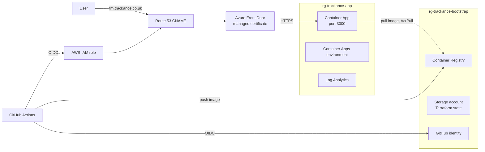

# Trackance - Azure Edition

The Trackance project tracker, rebuilt on Azure: containerised with Docker,
deployed to Azure Container Apps, provisioned with Terraform, and served over
HTTPS through Azure Front Door at tm.trackance.co.uk.


## Live App


### Project Overview

- **Terraform** provisions all Azure infrastructure, split into a bootstrap layer and an app layer
- **Azure Container Apps** runs the app, with logs sent to a **Log Analytics** workspace
- **Azure Front Door** serves HTTPS on the custom domain with a managed certificate
- **Azure Container Registry** stores images, tagged with the commit SHA
- **Managed identity** with AcrPull lets the app pull images with no passwords
- **Amazon Route 53** hosts the DNS, with the validation and CNAME records managed by Terraform
- **GitHub OIDC** gives the pipelines access to Azure and AWS with no long-lived keys
- **Multi-stage Docker build** on a distroless image, running as a non-root user

## Architecture Diagram



## Project Structure

```text
trackance-azure/
├── .github/workflows/
├── app/
├── bootstrap/
├── infra/
│   └── modules/
│       ├── log-analytics/
│       ├── container-env/
│       ├── container-app/
│       └── front-door/
├── clickops/
└── README.md
```

## Design Choices

### Container Apps over AKS

Trackance is one container. Container Apps runs it on Kubernetes underneath without me managing a cluster, and it costs nothing while idle. AKS would mean paying for nodes and running a cluster for a single app.

### Front Door over Application Gateway

Front Door is global, issues and renews the certificate for the custom domain, and doesn't need a virtual network. Application Gateway is regional, needs its own subnet and costs more to leave running.

### Separate Bootstrap Layer

State storage, the registry and the pipeline identities are long-lived, so they sit in their own resource group and their own Terraform folder, applied once from my laptop. The app layer can be destroyed and rebuilt without touching them.

### Least Privilege for the Pipeline

The GitHub identity has Contributor to deploy, AcrPush on the registry, and permission to assign roles on the registry limited by a condition to AcrPull only. On AWS, its role can only change records in the one hosted zone.

### DNS in Route 53

`trackance.co.uk` was already in Route 53 from my AWS projects. Terraform uses both providers, so the validation token from Front Door is written straight into the TXT record with no copying between consoles.

### Trade-offs

Data is stored in a JSON file inside the container, so it's lost when the app restarts or scales to zero. The Container App's own URL is public, so it can be reached without going through Front Door. For production I'd use a database, and Front Door Premium with Private Link so the app is only reachable through Front Door.

## Running the Application Locally

### Requirements

- Docker

### Start the Application

```bash
docker build -f app/Dockerfile -t trackance .
docker run --rm -p 3000:3000 trackance
```

- App: http://localhost:3000

### Stop the Application

Press `Ctrl+C`.

## CI/CD Workflows

### Build: builds the image, checks it responds, then pushes it to ACR tagged with the commit SHA


### Terraform Plan: runs fmt, validate and plan on pushes that change `infra/`


### Terraform Apply: manual, deploys a chosen image tag


### Terraform Destroy: manual teardown of the app layer

<!-- screenshot -->

### Deployment Workflow

1. A push that changes `app/` builds and tests the image, then pushes it to ACR tagged with the commit SHA
2. A push that changes `infra/` runs fmt, validate and plan
3. I review the plan, then run Terraform Apply with the image tag to deploy
4. Container Apps starts a new revision with the new image and moves traffic to it
