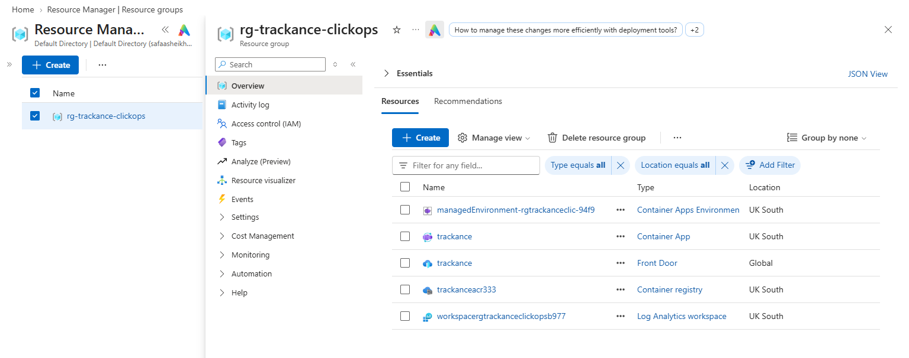
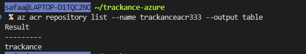
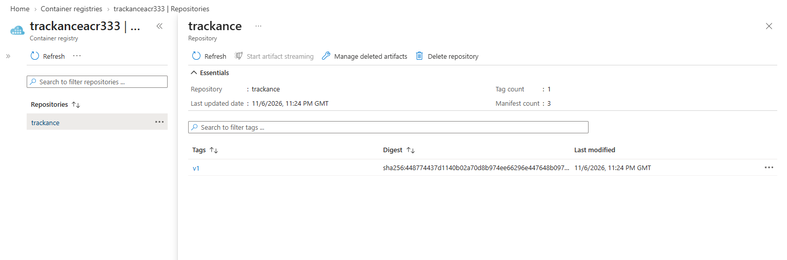
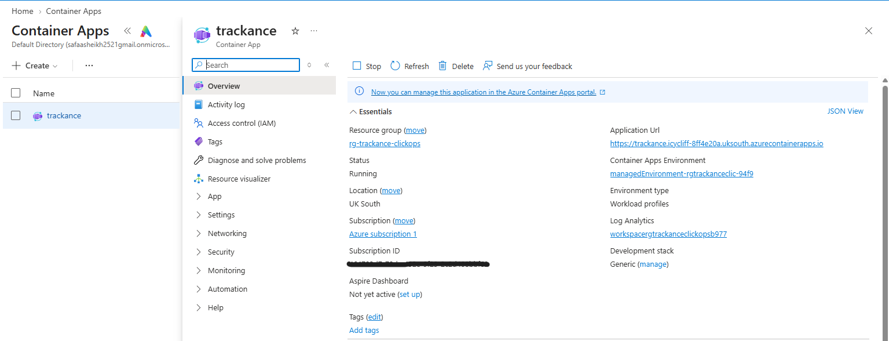
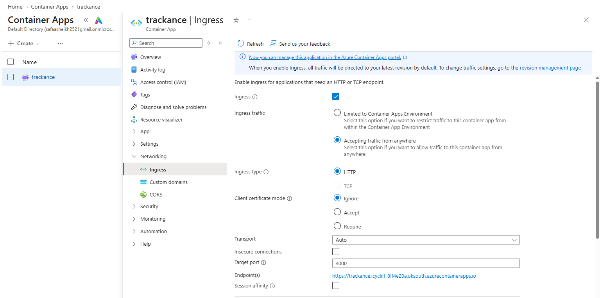
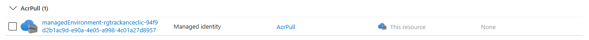
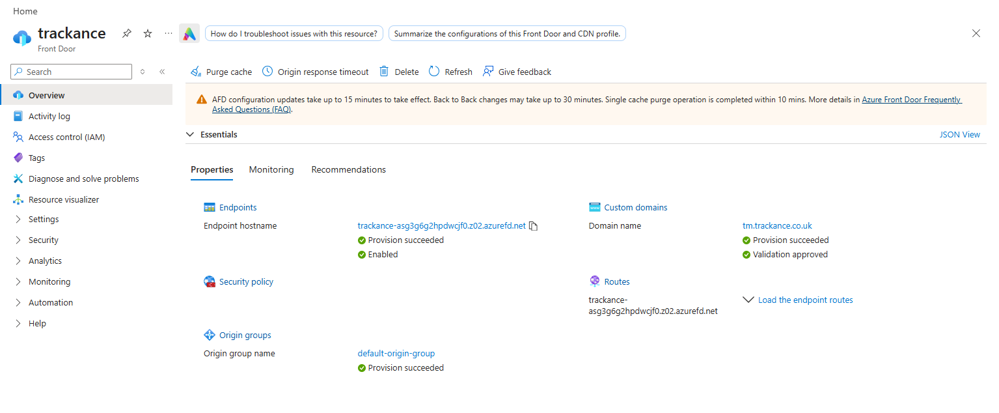
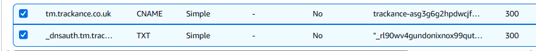
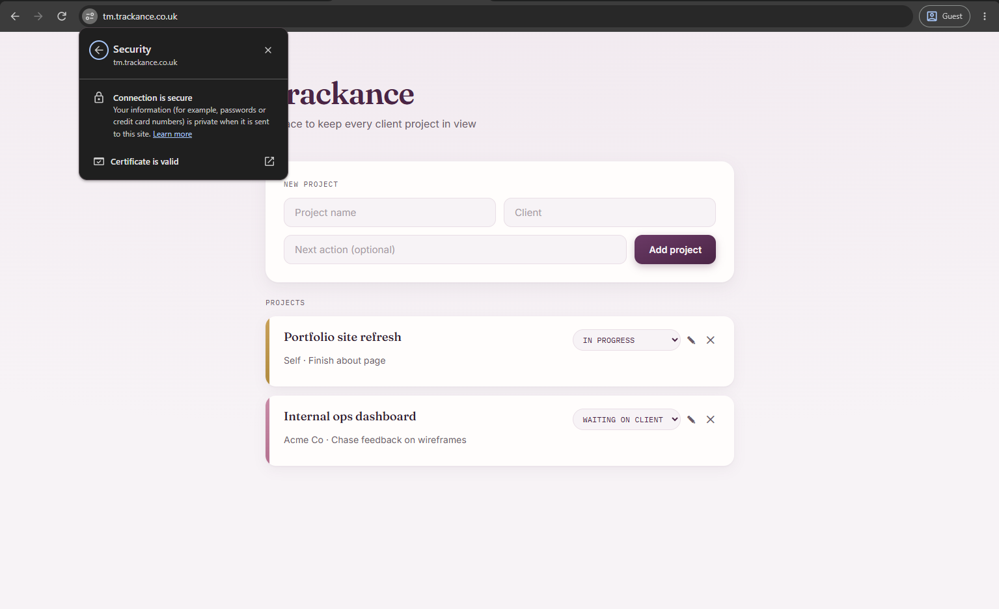

# Trackance on Azure (ClickOps)

Before writing any Terraform, I deployed Trackance manually through the Azure portal to understand how each piece fits together.

**Architecture:** User → Front Door (tm.trackance.co.uk) → Container App → image pulled from ACR



## 1. Resource group

Created `rg-trackance-clickops` in UK South to hold everything, so it can all be deleted in one go.

## 2. Container registry

Created an Azure Container Registry (Basic tier) called `trackanceacr333`.

Built and pushed the image from the repo root:

```bash
ACR=trackanceacr333
az acr login --name $ACR                                          # log Docker into the registry
docker build -f app/Dockerfile -t $ACR.azurecr.io/trackance:v1 .   # build the image
docker push $ACR.azurecr.io/trackance:v1                           # push it to ACR
az acr repository list --name $ACR --output table                  # confirm it arrived
```




## 3. Container App

Created a Container App called `trackance`. This also created a Container Apps environment and a Log Analytics workspace for its logs.

- **Image:** `trackanceacr333.azurecr.io/trackance:v1`
- **Registry access:** managed identity with the **AcrPull** role on the registry, so no passwords are stored.
- **Ingress:** external, HTTP, target port **3000** (the port the app listens on).





## 4. Front Door

Created a Front Door (Standard) profile with:

- **Endpoint:** the public Front Door URL.
- **Origin group:** pointing at the Container App's URL.
- **Route:** connecting the endpoint to the origin group.



## 5. Custom domain

Added `tm.trackance.co.uk` as a custom domain with a Front Door managed certificate. My DNS is in AWS Route 53, so I added two records there:

- **TXT** `_dnsauth.tm`: the validation value from Front Door, which proves I own the domain.
- **CNAME** `tm`: pointing at the Front Door endpoint hostname.

Once validation was approved, I associated the domain with the route.


